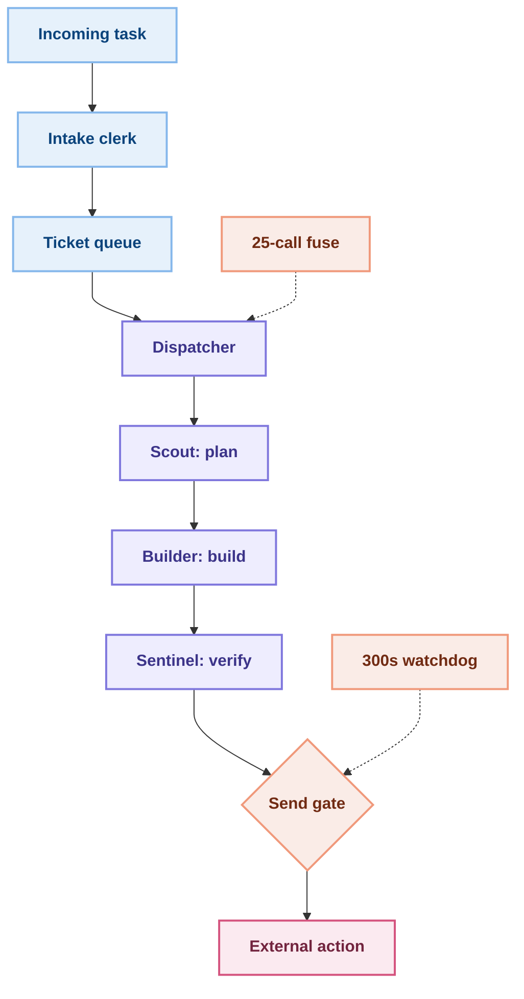
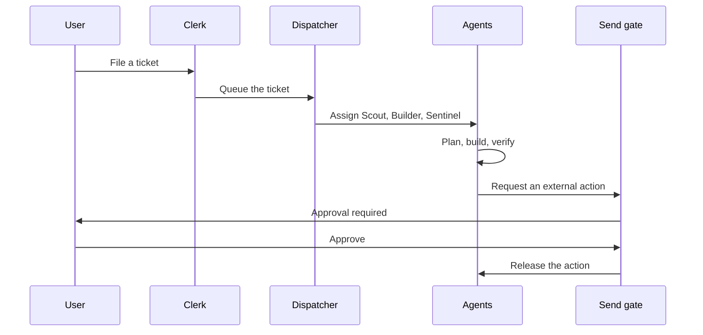

# S.O.U.L. - Agentic Ticket Agency

A multi-agent system that turns a real task into a ticket and ships it with guardrails. Built solo for Mondira's AI-Theory course in September 2026.

## How a ticket moves



The fuse and watchdog are cross-cutting controls. They are drawn as side inputs because they constrain the whole loop, not as stages in the pipeline.

## One ticket, end to end



## Quick start

```bash
python3 -m venv .venv && source .venv/bin/activate
pip install -r requirements.txt
python3 app.py
```

Open `http://localhost:8000` for the board. `data/tickets.json` holds the full history, including five shipped tickets and the failed ones.

For the fast watcher demo: `SOUL_WATCH_INTERVAL=15 python3 soul-watch.py`.

## Configuration

| Variable | Required | Default | What it does |
|---|---|---|---|
| `SOUL_MODEL` | No | `gpt-oss:120b-cloud` | Ollama model. `llama3.2:3b` is the offline fallback. |
| `SOUL_OLLAMA_URL` | No | `http://localhost:11434` | Ollama endpoint. |
| `SOUL_MAX_STEPS` | No | `8` | Maximum agent loop steps per ticket. |

The send gate covers `gmail_send` and `wa_send`. No external message leaves without approval.

## What it actually did

- **5 tickets shipped end-to-end:** password generator CLI, CSV to JSON, todo CLI, single-page site, dice roller.
- **25-call budget fuse** caught a real runaway (T-002 burned 26 calls) and stopped the bleed.
- **300-second watchdog** for unattended runs; 15s and 5s ticks for demos.
- **Fresh evaluation: 2 of 4 tickets passed.** Portfolio-class tickets correctly FAILED instead of being faked. The failures stay in `data/tickets.json` as evidence.
- **Live demo, 29 Sep 2026:** a real Gmail task was driven to DONE in front of the class.
- **Skill auto-learning** proven by T-005; the learned skills are in `skills/auto-t-*`.

Architecture and ReAct-loop diagrams: `docs/soul-architecture.mmd`, `docs/soul-react-loop.mmd` (rendered PNGs alongside).

## Design decisions

- `gpt-oss:120b-cloud` as the brain: strong reasoning, zero local RAM, needs internet. `llama3.2:3b` is one env var away for offline use.
- `qwen3:4b` and `deepseek-r1` were rejected: they emit chain-of-thought as visible content and break the JSON protocol.
- A 25-call fuse is observability, not just cost control. The history shows exactly why a ticket died.

## Project structure

```text
soul-agentic-agency/
├── agent.py          # agent loop and tool dispatch
├── crew.py           # Scout, Builder, Sentinel roles
├── intake.py         # ticket intake from email
├── tools.py          # tool registry and Sentinel checks
├── watchdog.py       # stall detection and restarts
├── soul-watch.py     # systemd watcher entry point
├── data/tickets.json # full evaluation history
├── skills/           # auto-learned skills from passed tickets
├── docs/             # Mermaid architecture diagrams
└── report/           # original course proposal
```

## Limitations

This is a course demo, not a production service. Two fresh tickets failed. The board has no authentication, so do not expose port 8000 publicly. Some tool paths assume the user's local Bourbon scripts exist. There are no automated tests.

## Status and privacy

Course project, not actively maintained as a product. No API keys or personal credentials are committed; the original intake email was replaced with `user@example.com`.

Author: Ishtiaq Ahmed, Department of CSE, Notre Dame University Bangladesh. Course report: `ID_35_SOUL_Agent_Report.pdf`.
